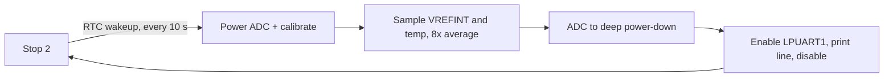

# STM32L432KC Ultra-Low-Power Temperature Node

Bare-metal firmware for the STM32L432KC (Cortex-M4F) that sleeps in **Stop 2**, wakes on an RTC timer, measures die temperature and supply voltage, reports over a UART, and goes straight back to sleep.

Written against CMSIS register definitions only: **no HAL, no LL, no heap, integer math only.**

## What it demonstrates

- Low-power mode entry and exit: Stop 2, `SLEEPDEEP`, wake-flag handling, and a sleep loop that tolerates spurious wakeups
- RTC wakeup timer on the 32.768 kHz LSE, routed through EXTI line 20 (no SysTick, so no periodic tick wakeups)
- ADC lifecycle management: voltage regulator, calibration and deep power-down around every measurement
- Accurate on-die temperature: factory `TS_CAL1`/`TS_CAL2` calibration points, compensated for the real supply voltage measured through the internal VREFINT channel
- LPUART1 clocked from LSE, so the baud rate does not depend on the system clock
- Defensive bring-up: every hardware wait is bounded, with an explicit fault path

## Wake cycle



Output is one line per sample at 9600 8N1:

```
T=23.09C VDDA=3312mV
```

`T` is die temperature in °C. `VDDA` is the analog supply in mV, derived from the internal reference. The sample above is real output from a NUCLEO-L432KC on the bench.

## Power strategy

| Decision | Why |
|---|---|
| Stop 2 between samples | Lowest-power Stop mode; SRAM and register state are retained, so execution resumes where it left off with no reboot |
| 4 MHz MSI (reset default), voltage range 2 | Keeps active current low; the active window is milliseconds, so clock speed is not the bottleneck |
| ADC fully powered down between samples | Deep power-down plus gated clock; recalibrating on each wake costs only tens of microseconds |
| Temp sensor and VREFINT enabled only during conversion | Both are always-on loads if left enabled |
| LPUART and its pin gated off between reports | TX pin is parked as an idle-high output, so a connected terminal sees no glitches |
| Unused debug pins parked in analog mode | They are the only pins not analog at reset; the SWD pins are left alone so the chip stays debuggable |

## How the temperature is computed

The datasheet's factory calibration was taken at VDDA = 3.0 V, but real boards run closer to 3.3 V, which would skew the reading. So each cycle:

1. Read the internal reference (VREFINT) and compute the actual supply: `VDDA = 3000 mV * VREFINT_CAL / VREFINT_DATA`
2. Read the temperature sensor and scale it to the 3.0 V calibration basis: `TS = TS_RAW * VDDA / 3000`
3. Linearly interpolate between the two factory points (30 °C and 130 °C) in fixed-point, in units of 0.01 °C

Each channel is the average of 8 conversions.

## Hardware

- NUCLEO-L432KC (32.768 kHz LSE crystal fitted; the firmware halts if the LSE does not start)
- UART output on PA2 (LPUART1_TX, AF8), which is the ST-LINK virtual COM port on the Nucleo-32

## Build and flash

1. Create an **STM32L432KCUx** project in STM32CubeIDE as an empty C++ project (no HAL).
2. Put ST's CMSIS headers in the project: the device headers (`stm32l432xx.h`, `stm32l4xx.h`, `system_stm32l4xx.h`) under `Drivers/CMSIS/Device/ST/STM32L4xx/Include`, and the Arm CMSIS-Core headers (`core_cm4.h` and friends) under `Drivers/CMSIS/Include`. They come from ST's `cmsis-device-l4` and `cmsis_core` repositories and keep their own licenses.
3. In **Project → Properties → C/C++ Build → Settings**, for **MCU G++ Compiler**:
   - Include paths: add both CMSIS folders above
   - Preprocessor: add the define `STM32L432xx`
4. Replace the generated `main.cpp` with `Src/main.cpp` from this repository.
5. Build, then **Run** (not Debug) to flash.
6. Open the ST-LINK virtual COM port at 9600 8N1, for example `screen /dev/tty.usbmodem<id> 9600` on macOS, and press the RESET button to see the first line.

## Power budget (estimated, not yet measured)

> These figures are **calculated from datasheet typicals, not bench measurements**. Measured results will replace them.

| Quantity | Estimate | Basis |
|---|---|---|
| Stop 2 current, RTC running on LSE | about 1.3 µA | STM32L432KC datasheet typical at 25 °C |
| Active window | about 25 ms | 22-character line at 9600 baud is about 23 ms, plus 1-2 ms for the ADC |
| Active current | about 0.5 mA (assumed) | about 84 µA/MHz at 4 MHz for the core (about 0.34 mA), plus ADC, regulator and LPUART |
| Charge per wake cycle | about 12 µC | 0.5 mA x 25 ms |
| Average current at a 10 s period | about 2.5 µA | formula below |

```
I_avg = (I_stop * (T - t_active) + Q_cycle) / T
      = (1.3 uA * 9.975 s + 12 uC) / 10 s  =  about 2.5 uA
```

Roughly half of that average comes from the awake window, and most of the awake window is the CPU polling while the UART shifts out the report. Sleeping during transmission (LPUART interrupt or DMA, which can wake the part from Stop 2) is the obvious next optimization.

Stop 2 leakage rises steeply with temperature, so these estimates apply near room temperature.

### How it will be measured

- Release (`-Os`) build, with the debugger disconnected and the board power-cycled (an attached debugger keeps clocks running in Stop mode)
- A µA-capable meter or current profiler in series with the MCU supply
- The MCU isolated from the Nucleo's ST-LINK and regulator, or measured on a bare module, because the ST-LINK dominates board current

## Limitations

- The reported value is **die temperature**, not ambient air temperature. The internal sensor has a typical accuracy of a couple of degrees, so treat it as a demonstration of the measurement chain rather than a calibrated thermometer.
- The power figures above are estimates until a bench measurement is added.
- The firmware requires the LSE crystal and halts safely if it does not start.
- Output is TX-only; there is no command interface.

## Possible extensions

- Standby or Shutdown with backup-register state for an even lower floor current
- An external sensor on I2C3 (it can wake the part from Stop 2), with its supply rail power-gated by a GPIO
- Logging to external SPI NOR flash and sending batches to amortize transmit cost
- Replacing the UART report with a low-power radio

## Project structure

```
Src/main.cpp   firmware: power, RTC, ADC, UART and the wake loop (single file)
```

## License

MIT. See the header of `Src/main.cpp`.
